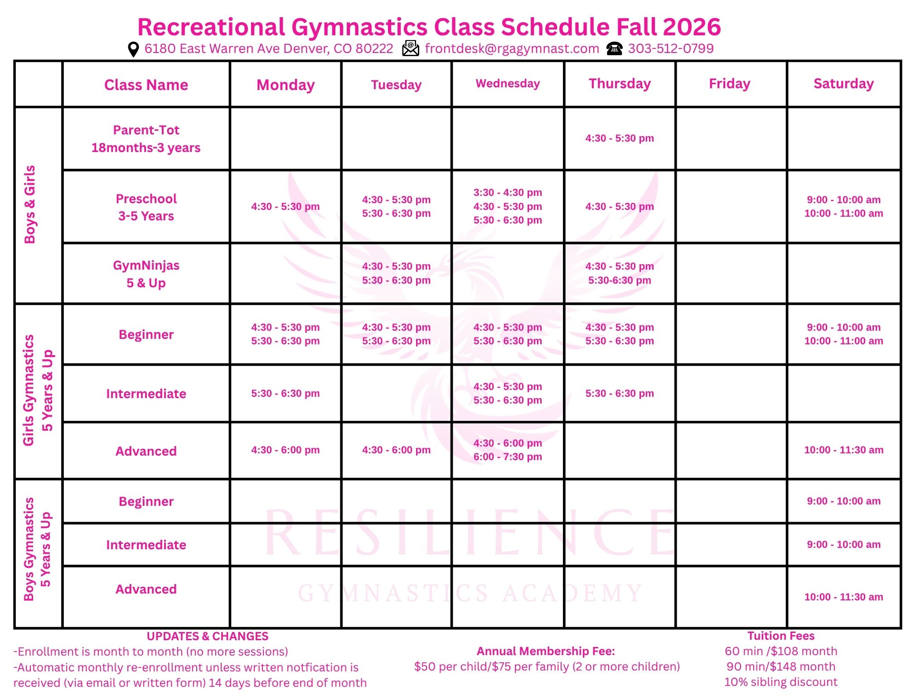

Web Application Framework - React/Vite/Tailwind 
Publishing to - siteground

## Deployment Information
- **Deployment Script**: `./deploy.sh` (builds the project via `npm run build` and syncs `./dist` to SiteGround via SFTP)
- **SFTP Host**: `ssh.colins110.sg-host.com`
- **SFTP Port**: `18765`
- **SFTP User**: `u3106-wgdlqfiup0tz`
- **Remote Directory**: `www/colins110.sg-host.com/public_html`
- **Ignored Credentials & Scripts**: `.access` and `deploy.sh` are in `.gitignore`

## Base information
This is a gymnastics website providing recreational and competitive gymnastics for kids.
Any stock images should be of kids enjoying gymnastics events such as uneven bars, floor, beam and vault.
# Recreational Gymnastics Schedule
The most current schedule for recreational gymnastics is always here  
If this file changes it should be updated on the website.