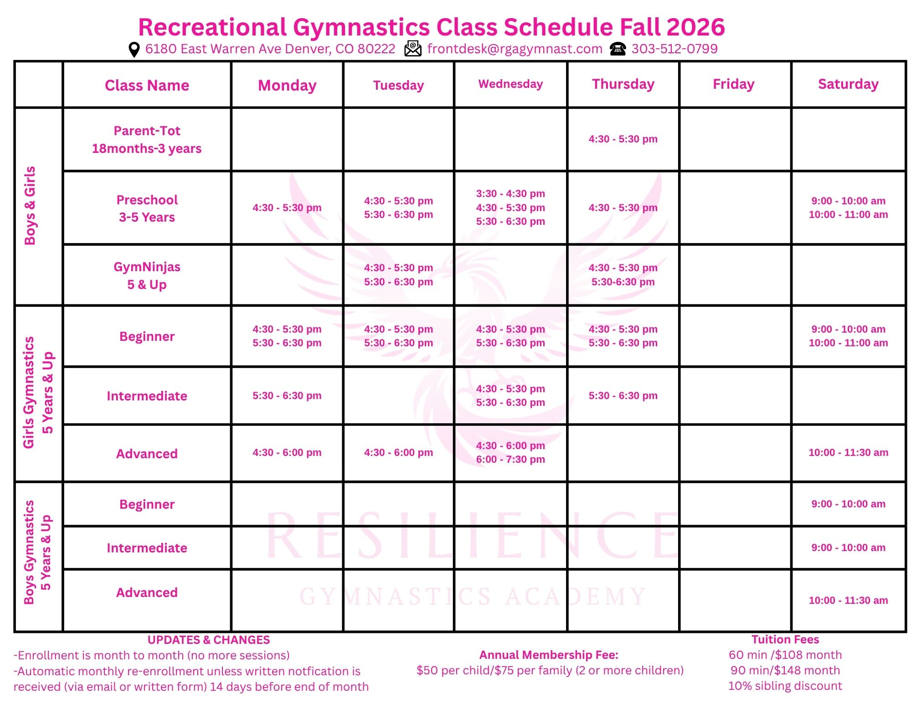

Update the site with a new layout. The new updated site will be a replacement for the content here https://rgagymnast.com/
Here are a list of local gymnastic gyms in the area.
[market-research.md](market-research.md)

The homepage should be a main landing page for the gym. The homepage should not be too cluttered.
https://achievesports.com/ is a good example of a good homepage.
The menu items from the home page are
- Classes - content from 
- Events - copy content from rgagymnast.com
- Birthday parties - look at markets research items for content
- Waivers - copy content from rgagymnast.com
- Team - New page. Copy the style from rgagymnast.com. Use the pink style and gymnast background.
- Payment Portal
- About - include contact info. clickable email link and map link. Contact email is frontdesk@rgagymnast.com.